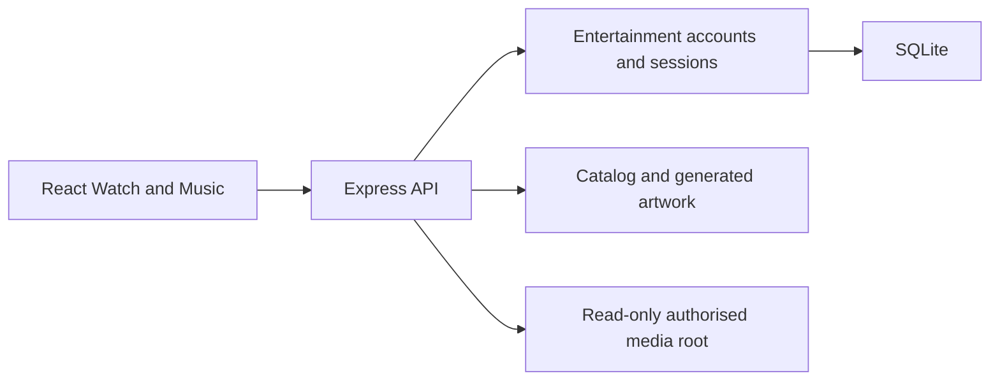

# Cine Music Wave Web

A personal cinema and music application for media you own or are authorised to
use. **Watch** organises local films and series; **Music** provides a library,
player, queue and collections. A React/TypeScript client talks to an Express
server that authorises requests and streams files from a confined media root.

This is a standalone extraction of Study Library's entertainment features.
Study, Markdown and Learning are not mounted here. The separate native mobile
app has its own data and permission model; it is not this website in a wrapper.

## Features

- Watch catalog, title/episode pages, playback planning, subtitles, resume and
  personal viewing state.
- Music browsing and search, album/artist/playlist views, queue, likes, playlists
  and playback controls.
- Entertainment accounts with server-side sessions and account-specific records.
- Dark and light themes, responsive phone/tablet/desktop layouts and reduced motion.
- Authorised byte-range media delivery, with optional local FFmpeg tools for
  supported playback preparation.

The catalog is built from local files. The app does not supply a subscription
catalog, scrape streaming services, bypass DRM or grant redistribution rights.
Live OAuth/email delivery and public-host behaviour need their own validation.

## Quick start

Requirements: **Node.js 22.5+**, **pnpm 11**, an authorised media folder, and
optional FFmpeg/ffprobe for features that use media probing or conversion.

From this repository's root:

```sh
pnpm install --frozen-lockfile
# Configure the ignored .env from .env.example for your own machine.
pnpm dev:local
```

Open **http://localhost:4040**. The development API runs on **4041** and is
proxied through same-origin `/api`. `pnpm dev` uses the same local launcher.
Study Library uses 4444/4445; keep these listeners separate.

Create an entertainment account in development, then open Watch or Music.
Production registration is closed unless explicitly enabled. A fresh checkout
has no personal media or account database, so an empty library is expected until
your media root is configured and indexed.

## Configuration

The reference is [.env.example](.env.example). Configuration is read by
`server/config/` and `server/auth/config.ts`; real secrets remain on the server.

| Setting                             | Purpose                                                                                 |
| ----------------------------------- | --------------------------------------------------------------------------------------- |
| `WATCH_MEDIA_DIR`                   | The media folder the server is allowed to read.                                         |
| `WATCH_ALLOWED_DRIVE`               | Windows drive confinement, default G; a mismatched root is refused.                     |
| `WATCH_CATALOG_DIR`                 | This app's generated catalog/artwork cache.                                             |
| `PERSONAL_DB_PATH`                  | SQLite account/personal-state file; default `data/cine-music-wave.sqlite`.              |
| `AUTH_PUBLIC_ORIGIN`                | Exact browser origin; required HTTPS in production.                                     |
| `AUTH_SESSION_SECRET`               | Stable server-only secret, at least 32 bytes in production.                             |
| `AUTH_ALLOW_PERSISTENT_SQLITE`      | Explicit opt-in to the supported single-instance persistent SQLite identity deployment. |
| `AUTH_SIGNUP_ENABLED`               | Registration policy; production defaults closed.                                        |
| `AUTH_TRUST_PROXY`                  | Explicit trusted proxy configuration when deploying behind a proxy.                     |
| `FFMPEG_PATH`, `WATCH_ENCODER`      | Optional local media-tool selection and encoder policy.                                 |
| `PORT`, `ENTERTAINMENT_SERVER_HOST` | API/production listener configuration.                                                  |

The current owner setup has used a shared SQLite file with Study Library through
`PERSONAL_DB_PATH`. The apps use separate account tables and cookies, but a shared
file is still a shared security/backup boundary. Inspect your deployment choice
before exposure or migration; do not assume the default path describes an
existing installation.

## Architecture



| Location                                     | Responsibility                                                       |
| -------------------------------------------- | -------------------------------------------------------------------- |
| `src/features/auth/`                         | Sign-in and profile interfaces.                                      |
| `src/features/watch/`, `src/features/music/` | Catalog and player experiences.                                      |
| `src/routes/`, `src/api/`                    | Address navigation and API adapters.                                 |
| `src/themes/`, `src/content.model.json`      | Shared design tokens, motion and copy.                               |
| `server/auth/`                               | Accounts, credential hashing, sessions and personal-data operations. |
| `server/watch/`, `server/music/`             | Media indexing, streaming and account-specific media state.          |
| `server/middlewares/`                        | Request protections, errors, limits, headers and static assets.      |
| `scripts/`, `tests/`                         | Local launch/build operations and verification.                      |

Webpack produces the browser bundle. The production Express process serves both
the bundle and API. Media IDs resolve through the catalog rather than being used
as arbitrary paths. Original media stays in place; generated catalog/artwork is
separate from source files.

## Data and privacy

Passwords use the server's scrypt implementation; sessions and personal records
are stored in SQLite. Entertainment records use their own table namespace and
cookies. They do not inherit Study accounts or collections. Browser preferences
use application-specific keys.

Back up the configured SQLite file with an online SQLite backup procedure and
test restoration. Back up media separately; generated caches are not substitutes
for source media or account backups. Read [SECURITY.md](SECURITY.md) and
[SECURITY_VALIDATION.md](SECURITY_VALIDATION.md) for controls, findings and limits.

## Development and verification

| Command                                                    | Purpose                                                                                     |
| ---------------------------------------------------------- | ------------------------------------------------------------------------------------------- |
| `pnpm check`                                               | TypeScript, oxlint and Biome formatting.                                                    |
| `pnpm test:auth`, `pnpm test:server`, `pnpm test:security` | Account, server and adversarial request checks.                                             |
| `pnpm test:watch`, `pnpm test:music`, `pnpm test:motion`   | Media rules and UI motion checks.                                                           |
| `pnpm build`                                               | Production compilation, browser assets and compression twins.                               |
| `pnpm test:build`                                          | Output/budget checks after building.                                                        |
| `pnpm audit:standards`, `pnpm deps:audit`                  | Static standards review and production advisories.                                          |
| `pnpm test:e2e`                                            | Browser parity/playback suite with its documented running services and authorised fixtures. |

Browser parity tests need the required running apps and real media fixtures.
A successful build does not establish codec support or real playback. Dated
results and incomplete checks are recorded in [VALIDATION.md](VALIDATION.md).

## Production and operation

```sh
pnpm build
pnpm serve
```

Production defaults to port **4040**. Configure HTTPS, stable secrets, the exact
public origin, durable SQLite storage, proxy trust, registration policy and
backups before use. `serve` runs an existing build; it does not rebuild it.

The optional `scripts/host-public.ps1` launcher exposes a production service
through a tunnel. Running it publishes access to this machine's application;
review [OPERATIONS.md](OPERATIONS.md), media-sharing rights and the shared database
decision first. A temporary tunnel is not a durable hosting or backup plan.

## Troubleshooting

| Symptom                        | Check                                                                               |
| ------------------------------ | ----------------------------------------------------------------------------------- |
| Catalog is empty               | Media-root configuration, supported files and catalog scan state.                   |
| Media returns 403              | Allowed-drive/root policy and sign-in; keep confinement enabled.                    |
| A file will not play           | Codec/container support and FFmpeg availability; read playback diagnostics locally. |
| Sign-in fails after deployment | Exact public origin, HTTPS, stable secret and cookie/proxy configuration.           |
| Mobile has a different library | Native mobile reads permitted device media and does not sync this server catalog.   |

## Project documents

Start with [system_design.md](system_design.md), the local maintainer notes,
[OPERATIONS.md](OPERATIONS.md) and [AUTH_SETUP.md](AUTH_SETUP.md).
The [mobile replication guide](MOBILE_REPLICATION_GUIDE.md) describes the separate
native implementation. Online native accounts/sync remain future work described
in [FUTURE_ONLINE_BACKEND_PLAN.md](FUTURE_ONLINE_BACKEND_PLAN.md).

[AGENTS.md](AGENTS.md) is the authoritative contribution standard. Preserve the
approved design and keep declared shared server fixes in step with Study Library.
Dependency licence information is in [THIRD_PARTY_NOTICES.txt](THIRD_PARTY_NOTICES.txt)
and [LICENSE_REVIEW.md](LICENSE_REVIEW.md).

## Publication rules

Maintainer feature logs stay local and are excluded from source control. Do not
force-add or publish them. Enable the repository's push guard after cloning:

```sh
git config core.hooksPath .githooks
```

Run `node --test scripts/publish-guard.checks.mjs` to verify the guard. It checks
the complete history being pushed, including files deleted by later commits.
