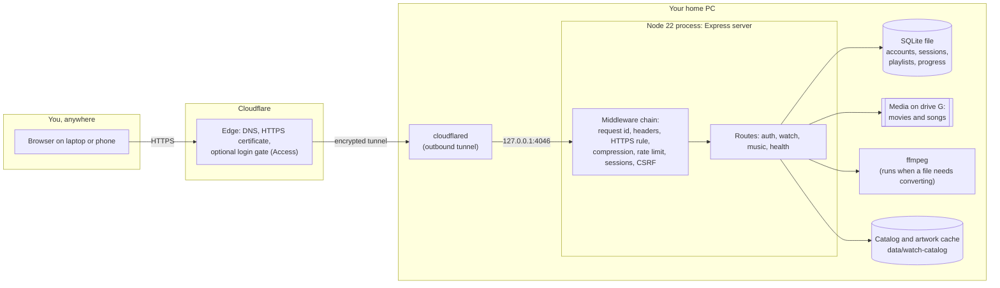

# From idea to a live website: the full design of Cine Music Wave

Written for the owner, who is building this to learn how real apps are designed, built, deployed and kept running, and to
show that work in a portfolio. It follows one app (Cine Music Wave Web, with its Android sibling) from the first idea to a
website you can open from anywhere, and it says plainly which parts are done, which were checked, and which are only a plan.

Tags used below:

- **[done]** exists in the code or on this PC and was checked in this project.
- **[done, not tested]** exists but nobody has run it end to end.
- **[proposed]** a recommendation. Nothing has been built or run for it yet.

Dated 2026-10-26. Related files: `AGENTS.md` (the rules every change follows), `system_design.md` (decisions and the design
record), `OPERATIONS.md` (how to run it), `FEATURE_LOG.md` (what changed and when), and Study Library's
`DEPLOYMENT_GUIDE.md` (the longer hosting guide, written for the sister app).

---

## 1. What we are building, and what "finished" means

**The product.** A private cinema and music player. Your own movies and songs stay on your PC's drives. A web app (and an
Android app) lets you browse, search, play, resume where you stopped, make playlists and switch audio tracks, from your PC or
from a laptop or phone when you travel.

**Why it exists.** Three goals, in this order:

1. You learn the whole life of an app: design, build, test, secure, deploy, operate, update.
2. It becomes a portfolio piece that shows engineering judgement, not only screens.
3. You use it yourself when you are away from home.

**Who uses it.** One person: you. That shapes everything. There is no sign-up page for the public, no admin team, no
payments, no email campaigns. It means we can choose simple, durable parts (one SQLite file, one server process) over
cloud-scale parts. It does not mean we can be careless: the moment a server is reachable from the internet, strangers' scripts
will find it within hours, so it is built and run as if it were public.

**What "done" means for each stage.** An app can be in four states, and portfolio work usually stops too early:

| State | Meaning | Where we are |
| --- | --- | --- |
| Built | Features work on your PC | [done] |
| Verified | Tests, security checks, browser and phone checks pass | [done] (section 9 lists what was run) |
| Deployed | Reachable at a real web address over HTTPS | [done] for a temporary address, [proposed] for a permanent one |
| Operated | Survives reboots, is backed up, is watched, can be updated and rolled back safely | [proposed] (this is the next job) |

**Success criteria** (so "done" is measurable, not a feeling):

- Opens from a phone on mobile data, signs in, and plays a song and a film within a few seconds.
- Comes back by itself after a Windows restart or a power cut.
- You find out within minutes when it is down (and you know when your PC is simply switched off).
- A database backup exists from the last 24 hours and you have restored one at least once.
- An update takes under ten minutes and has a one-command way back.
- The portfolio page explains the design in five minutes without you in the room.

---

## 2. The system on one page



Read it left to right. Your browser talks only to Cloudflare. Cloudflare talks to a small program on your PC
(`cloudflared`) over a connection that your PC opened outward, which is why you need no router settings. That program hands
requests to your own server on `127.0.0.1`, an address no other computer can reach directly. The server reads and writes
one SQLite file and reads your media from `G:`.

### The parts, one by one

| Part | Where it lives | What it does | Why this choice |
| --- | --- | --- | --- |
| Web client | `src/` (React 19, TypeScript, Webpack 5) | Screens, routes, playback controls, animations | React is the market standard; TypeScript catches mistakes before users do |
| Server | `server/` (Node 22, Express 5) | Authentication, API, streaming, security rules | One language on both sides; Express is simple to read and teach |
| Accounts and state | one SQLite file (`study-library.sqlite`) | Users, sessions, playlists, likes, watch progress | One file is easy to back up and needs no database server for one user |
| Media | folder on `G:` | Your movies and songs, never copied or changed | Large files stay where they are |
| Catalog | `data/watch-catalog/` | A list of titles, artwork and thumbnails built from your folders | Can be rebuilt at any time, so it is not backed up |
| Converter | `ffmpeg` (in Study's `.tools/`) | Turns a file the browser cannot play into one it can | Browsers cannot play every format |
| Tunnel | `cloudflared` (in Study's `.tools/`) | Makes the PC reachable without opening the router | No port forwarding, free certificates |
| Mobile app | `mobile apps/Cine Music Wave Mobile` (React Native) | Plays media that is already on the phone, fully offline | Separate product; no network permission on purpose |

---

## 3. Design decisions and the trade-offs behind them

Each row is a decision someone could reasonably have made differently. Being able to explain these is what makes a
portfolio project convincing.

| Decision | Alternative | Why we chose this | What it costs |
| --- | --- | --- | --- |
| One server serves the web app and the API on the same address (`/api/...`) | Frontend on one host, API on another | No cross-site cookies, no CORS rules to get wrong, one HTTPS name | Cannot host the frontend on a static CDN alone |
| Server-side sessions in an HttpOnly cookie, stored as hashes | JWT tokens kept by the browser | A session can be revoked at once; script injection cannot read the cookie | The server must keep session state |
| Passwords hashed with scrypt and a per-user salt | Plain or fast hashes | Slow on purpose, so stolen hashes are hard to crack | A little CPU on each sign-in |
| Registration closed in production | Open sign-up | Only people you already created can get in | You create any new account yourself |
| SQLite, one process | PostgreSQL or a managed database | No server to run or pay for; fine for one user | One writer at a time; cannot run two copies of the server against it |
| Stream files in byte ranges | Download the whole file first | Seeking and resuming work; memory stays small | More code than a static file server |
| Convert with ffmpeg only when needed | Pre-convert everything | No duplicate library, no waiting | The first play of an unusual file is slower |
| Tunnel from the PC | Open router port, or rent a server | Free, secure by default, works behind any home internet | Site is up only while the PC is on |
| Layered backend (config, middlewares, routes, services) | One big file | Each layer can be tested alone; new people find things | More files |
| Spring animations from physics, written as CSS | Fixed-time easing | Motion feels like iOS; tuned by two numbers | A generated file to keep in step |
| Mobile app has no internet permission | Mobile talks to the hosted server | It works on a plane and cannot leak anything | No sync between phone and PC (planned later) |

---

## 4. How one request travels (and which guard it meets)

Two journeys show every layer.

### Signing in

1. The browser asks for `https://your-address/`. Cloudflare terminates HTTPS and passes it through the tunnel.
2. The server adds a request id, then security headers (Content-Security-Policy, HSTS, no sniffing, no framing), then checks
   the request really came over HTTPS (it trusts the tunnel because `AUTH_TRUST_PROXY=loopback`).
3. The page loads from the build folder (`dist`). Files with a hash in their name are cached for a year; the HTML shell is
   never cached, so an update shows up at once.
4. You submit the form. The server rate-limits sign-in attempts per address, checks the CSRF token and that the request's
   origin equals `AUTH_PUBLIC_ORIGIN`, compares the password hash in constant time, and replies the same way for "no such
   user" and "wrong password" so nobody can learn which names exist.
5. On success it creates a random session, stores only its hash, and sets two cookies named with the `__Host-` prefix
   (HTTPS only, no domain tricks, HttpOnly for the session).

### Playing a song

1. The page asks `/api/music/library`. The server checks the session first; with no valid cookie the answer is 401 and no
   data leaves.
2. You press play. The browser asks `/api/music/stream/<id>` with a `Range` header (for example "bytes 0 to the end").
3. The `<id>` is looked up in the catalog; it is never used as a file path. The resolved path must sit inside the media
   folder, on the allowed drive, or the answer is 403.
4. The server sends only the requested bytes, so skipping ahead is instant and a 100 MB file never sits in memory.
5. Progress and likes are written to SQLite with parameterised queries (no string-built SQL).

---

## 5. Environments and configuration

| | Development | Production on your PC |
| --- | --- | --- |
| Command | `pnpm dev:local` | `pnpm build`, then `scripts\serve.mjs` (or `scripts\host-public.ps1`) |
| Web / API | `localhost:4040` / `localhost:4041` (hot reload) | one port, `127.0.0.1:4046` |
| Address people use | `http://localhost:4040` | `https://<your hostname>` |
| `NODE_ENV` | development | production |
| Sign-up | open | closed unless `AUTH_SIGNUP_ENABLED=true` |
| Cookies | plain names | `__Host-` names, Secure |
| Source maps | served to the dev tools | hidden, never served |

Configuration is read once, at start, from environment variables. If a required value is missing or weak, the server
refuses to start and says why (for example a session secret under 32 bytes). Anything secret lives in `.env` or in the
service's environment and never in git.

Production values (do not put these in `.env`, because `.env` is also read by `pnpm dev:local`, where the address must be
`localhost`; give them to the service as its own environment, or let `host-public.ps1` set them for a quick tunnel):

```text
NODE_ENV=production                 (scripts\serve.mjs sets it)
PORT=4046
ENTERTAINMENT_SERVER_HOST=127.0.0.1
AUTH_PUBLIC_ORIGIN=https://<your hostname>
AUTH_ALLOW_PERSISTENT_SQLITE=true   (you confirm: one process, durable disk)
AUTH_TRUST_PROXY=loopback
AUTH_SIGNUP_ENABLED=false
```

Values that stay in `.env` for both: `AUTH_MODE`, `AUTH_SESSION_SECRET`, `PERSONAL_DB_PATH`, `WATCH_MEDIA_DIR`,
`WATCH_ALLOWED_DRIVE`, `FFMPEG_PATH`.

---

## 6. The whole journey, phase by phase

This is the part to reuse for the next app. For each phase: what it is, what we did here, what is left.

### Phase 1: Idea and requirements

*What it is.* Write down who the user is, the three journeys that matter, what you store, and what you refuse to build.
*Here [done].* Journeys: sign in, find something, play it and come back to it. Not built on purpose: public sign-up, payments,
social features. *Left.* Nothing; keep this section true when scope changes.

### Phase 2: Design before code

*What it is.* Decide the look, the structure and the rules before building, so you build from a record rather than from habit.
*Here [done].* The design record (palette, fonts, icons, motion) is in `system_design.md`. Structure and rules are in
`AGENTS.md`. The three named springs (snappy, smooth, bouncy) come from physics, not guessing. *Left.* Add a one-page
"architecture decision record" per big choice as you make it (section 3 is the start).

### Phase 3: Repository and tooling

*What it is.* One command each for check, test, build, audit, so anyone (including future you) can verify a change.
*Here [done].* `pnpm check` (typecheck, lint, format), `pnpm test:*`, `pnpm build`, `pnpm audit:standards`,
`pnpm deps:audit`. *Left [proposed].* Put the code on GitHub with history (Web and Mobile are not git repositories yet) and
turn those commands into an automatic pipeline (section 8).

### Phase 4: Backend skeleton, security first

*What it is.* Build the walls before the rooms: configuration, headers, rate limiting, error handling, health route,
graceful shutdown. Every later feature inherits them.
*Here [done].* `server/app.ts` builds the app with `createApp(config)`, `middlewares/` holds request id, headers, rate limit,
compression, static files and proxy handling. 11 server tests and 11 attack tests start the real app and attack it.

### Phase 5: Features, one journey at a time

*What it is.* Build, test, look at it in a real browser, write the change-log entry, repeat.
*Here [done].* Sign-in, Watch (catalog, playback, audio and subtitle tracks, picture crop, resume), Music (library, queue,
playlists, lyrics, full-screen player). *Left.* The backlog is yours to choose; keep each item small enough for one entry.

### Phase 6: Testing, in layers

| Layer | Example here | Status |
| --- | --- | --- |
| Unit tests | queue rules, filename parsing, spring physics | [done] |
| API tests (real server, real HTTP) | `tests/server`, rate limit, static files | [done] |
| Attack tests | no session, forged cookie, CSRF, path traversal, leaky errors, sign-in guessing | [done] |
| Build tests | bundle size under 250 KB first load, hashed files, compressed copies | [done] |
| Browser tests | real Edge: sign-in, screens at several sizes | [done] for sign-in; Playwright parity suite [not run this round] |
| Device tests | Android emulator, release build, offline | [done] |
| Autonomous pentest (Strix) | needs Docker and an AI key | [not run] |

### Phase 7: Package

*What it is.* Turn source into the exact files you will run.
*Here [done].* `pnpm build` produces `dist/` with hashed file names, Brotli and gzip copies, hidden source maps, fonts
served from your own server. A test fails the build if the first load grows past 250 KB.

### Phase 8: Deploy

*What it is.* Put the packaged app on a machine that stays on, behind HTTPS.
*Here [done].* `scripts\host-public.ps1` starts the server and a free Cloudflare quick tunnel and prints an address.
It was started and 23 outside-visitor checks passed. The address is random and disappears when the script stops, so this
is a rehearsal, not a deployment you can rely on. The permanent version is section 7.

### Phase 9: Domain, DNS, certificates

*What it is.* A name people can remember, pointed at the tunnel, with a certificate so browsers trust it.
*Here [proposed].* Buy a domain (about 10 USD a year), add it to a free Cloudflare account, create a named tunnel.
Cloudflare issues and renews the certificate; you never install one.

### Phase 10: Operate

*What it is.* The unglamorous half: starting after reboots, backups, monitoring, updates, rollbacks.
*Here.* Backups exist as `pnpm db:backup` in Study Library [done, not tested for restore]; services, monitoring and
a restore rehearsal are [proposed]. Section 8 is the runbook.

### Phase 11: Evolve

*What it is.* Change a running app safely: small changes, automatic checks, a release you can name and roll back to.
*Here [proposed].* GitHub, a CI workflow, version tags, a short release note each time.

### Phase 12: Present

*What it is.* Make the work legible to someone who will spend five minutes on it. See section 11.

---

## 7. Getting from a rehearsal to a permanent website

Pick a stage; each one adds something real to learn and none needs the next.

| Stage | What you add | Cost | What you learn | Status |
| --- | --- | --- | --- | --- |
| 0. Quick tunnel | `host-public.ps1`, random address | free | tunnels, `AUTH_PUBLIC_ORIGIN`, production mode | [done] |
| 1. Named tunnel on your domain | fixed `https://cmw.yourdomain.com` | domain about 10 USD a year | DNS, certificates, tunnel credentials | [proposed] |
| 2. Run as a service | starts at boot, restarts on crash | free | Windows services, environment for services | [proposed] |
| 3. Login gate in front (Cloudflare Access) | a second lock before the app sees any request | free for a handful of users | zero-trust, defence in depth | [proposed] |
| 4. Always-on host (optional) | small rented server or a spare mini PC | a few USD a month | Linux, firewalls, deploying to a remote machine | [proposed] |

A private alternative worth knowing: **Tailscale** puts your PC and phone on a private network, so there is no public address
at all. For one traveller it is simpler and safer than a public site. It teaches less about the public internet, which is
why the plan above keeps the public path and adds Access as the guard.

### Stage 1 and 2 in commands [proposed, not run here]

Check Cloudflare's current documentation first; their dashboard and command names change.

```powershell
# one time, in a normal PowerShell, with your Cloudflare account and domain ready
cloudflared tunnel login
cloudflared tunnel create cine-music-wave
cloudflared tunnel route dns cine-music-wave cmw.yourdomain.com
# C:\Users\<you>\.cloudflared\config.yml
#   tunnel: <the id printed by "create">
#   credentials-file: C:\Users\<you>\.cloudflared\<id>.json
#   ingress:
#     - hostname: cmw.yourdomain.com
#       service: http://127.0.0.1:4046
#     - service: http_status:404
cloudflared service install        # starts the tunnel at boot
```

A Windows service runs as a system account, not as you, so it may not find `config.yml` and the credentials file under your
user folder. If the service starts but the tunnel does not connect, copy both to the folder Cloudflare's documentation names
for services, or pass the config path explicitly. This is the usual first snag, and a good one to learn from.

```powershell
# run the app as a service (NSSM), in an Administrator PowerShell, after "pnpm build"
nssm install CineMusicWave "C:\Program Files\nodejs\node.exe" "scripts\serve.mjs"
nssm set CineMusicWave AppDirectory "E:\New repos for portfolio\Cine Music Wave Web"
nssm set CineMusicWave AppEnvironmentExtra PORT=4046 ENTERTAINMENT_SERVER_HOST=127.0.0.1 AUTH_PUBLIC_ORIGIN=https://cmw.yourdomain.com AUTH_ALLOW_PERSISTENT_SQLITE=true AUTH_TRUST_PROXY=loopback AUTH_SIGNUP_ENABLED=false
nssm set CineMusicWave Start SERVICE_AUTO_START
nssm start CineMusicWave
```

If NSSM rejects the one-line list of variables, run `nssm edit CineMusicWave` and type them one per line on the Environment
tab. Do not put them in `.env`.

Also: set the Windows power plan to never sleep, turn on automatic start after a power cut in the BIOS if it offers it, and
bind nothing to your router.

### Stage 3: the second lock

In Cloudflare's Zero Trust dashboard add an "Access application" for `cmw.yourdomain.com` with one rule: allow only your
email address, verified by a one-time code. Strangers then meet Cloudflare's login page and never reach your server. Your own
sign-in still happens inside, so there are two independent checks. Test that streaming a long film still works through it.

---

## 8. Running it for months: the runbook

### Daily and weekly habits

| When | Do | How |
| --- | --- | --- |
| Always | Know if it is down | Add `https://cmw.yourdomain.com/api/health` to a free uptime monitor (UptimeRobot, Better Stack or similar) with email alerts. Expect an alert when your PC is off. |
| Daily | Back up the database | `pnpm db:backup <folder>` in Study Library (it copies `study-library.sqlite`, which this app also uses), scheduled in Windows Task Scheduler |
| Weekly | Check dependencies | `pnpm deps:audit` and `pnpm outdated`; update one thing at a time, then run all checks |
| Monthly | Practise a restore | Copy last backup to a scratch folder, start a server against it with another port, sign in, look at your playlists |
| Each Windows update | Check it came back | Open the health address from your phone on mobile data |

What is **not** backed up by anything today [proposed]: your media on `G:` (the app only reads it) and the catalog (it is
rebuilt from the media, so it does not need a backup).

### Updating the app

1. Back up the database. Migrations only move forward, so the backup is your way back.
2. Get the new code (`git pull` once the project is on GitHub).
3. `pnpm install --frozen-lockfile`, then `pnpm check`, the `test:*` commands, `pnpm build`.
4. Restart the service (`nssm restart CineMusicWave`).
5. Open `/api/health`, sign in, play one song and one film.
6. Write the change-log entry.

**Rolling back:** check out the previous tag, `pnpm install --frozen-lockfile`, `pnpm build`, restart. If a database
migration ran and the old code cannot read it, restore the backup from step 1.

### When something breaks

| Symptom | First look |
| --- | --- |
| Address does not load | Is the PC on? Is `cloudflared` running? Is the server answering on `127.0.0.1:4046/api/health`? |
| Signs you out at once | `AUTH_PUBLIC_ORIGIN` does not match the address in the browser exactly, or `AUTH_TRUST_PROXY` is wrong |
| Server will not start | The message names the missing setting (session secret, persistent-SQLite flag, address not HTTPS) |
| Playback stalls | Home upload speed is the limit; also check the PC is not asleep |
| Everything slow after an update | Roll back first, investigate second |
| Logs | The service log files (set with `nssm set CineMusicWave AppStdout ...`) and the browser's network tab; every error response carries a `requestId` you can search for |

### Secrets and rotation

- The session secret signs nothing that cannot be reissued: changing it signs everyone out, which is fine for one user.
  Rotate it after any suspicion and before publishing code.
- Never put `.env`, database files, media, tunnel credentials (`~/.cloudflared/*.json`) or logs in git. Run
  `pnpm audit:standards` before each push; it scans for secret-shaped text.
- If something secret was ever committed, change the secret. Deleting the file from history is not enough.

---

## 9. What has been checked so far

| Check | Result (2026-10-26) |
| --- | --- |
| Typecheck, lint, format | pass |
| Web tests: auth 20, watch 43, music 37, motion 6, server 11, security 11 | all pass |
| Production build and build tests (6) | pass |
| Dependency audit | no known vulnerabilities |
| Standards audit | 0 errors, 7 warnings (large files), design notices |
| Public address, visitor checks (23) | all pass: HTTPS, security headers, protected routes refuse visitors, sign-up closed, secrets and source not reachable, cookies Secure |
| Android release build on the emulator | installed; login via Skip Login; Music and Watch load; spring motion recorded |

Not checked: signing in and playing media through the public address (needs your password: please try it), the
Playwright parity suite, Core Web Vitals on a slow phone, a restore from backup, a reboot with services installed, Strix.

---

## 10. Security in one table

| Threat | Control | Where |
| --- | --- | --- |
| Guessing passwords | scrypt hashes, rate limit, same message for every failure | `server/auth`, `middlewares/rate-limit.ts` |
| Stealing a session | HttpOnly `__Host-` cookie, Secure, only hashes stored, idle and absolute expiry | `server/auth/sessions.ts` |
| Another site making your browser act | CSRF token plus origin check | `server/auth` |
| Reading files outside the media folder | catalog ids not paths, confinement to the root and drive | `server/watch/root.ts` |
| Script injection | strict Content-Security-Policy, no raw HTML rendering | headers, React |
| Leaking details in errors | one error body (`code`, `message`, `requestId`), no stack or path | `middlewares/request-context.ts` |
| Strangers registering | registration closed in production | `AUTH_SIGNUP_ENABLED` |
| Someone on your Wi-Fi reaching the server | bind to `127.0.0.1`; only the tunnel connects | `ENTERTAINMENT_SERVER_HOST` |
| Old vulnerable packages | `pnpm deps:audit` with overrides when a patch exists | `package.json` |

Remaining gaps: no second login gate yet (stage 3), no email for password reset (needs a Resend key), no autonomous
pentest, the sign-in screen still shows "Create an account" although registration is closed.

---

## 11. Making it a portfolio piece

The same work reads very differently with the right framing.

**On GitHub (one repository per app):** `cine-music-wave-web`, `cine-music-wave-mobile`, and `study-library` (already has a
remote). Each needs:

1. A README with: the problem in two sentences, a screenshot or short video, the architecture diagram from section 2, the
   stack, how to run it locally in five commands, and a "what I learned" paragraph.
2. A `docs/` folder with this guide's relevant parts, `system_design.md` and the decision table.
3. The test and security evidence: counts per suite, the attack-test list, the audit output.
4. A clean `.gitignore` check before the first push: no `.env`, no database, no media, no logs (the hosting logs contain
   tunnel addresses), no `.tools`, no `validation` screenshots of your private library.

**The live link.** You use the real instance for yourself, with your own media, so it should not be a link for strangers. For
a recruiter, show a 60 to 90 second screen recording of the real app on your phone and laptop, and the screenshots. If you
want a clickable demo, run a second instance with a few sample files and a demo account, on a separate hostname.

**A case study page** (one page, 600 to 900 words): the goal, the three design decisions you are proudest of (section 3),
one problem you hit and how you found it (for example the audit that silently scanned nothing, or the public address not
resolving for five minutes), the numbers (tests, budgets, security checks), and what you would do with more time.

---

## 12. Known gaps in the design (be honest about them in interviews)

1. **Two apps share one database file by path.** Cine Music Wave Web and Study Library both open `data/study-library.sqlite`
   inside Study's folder. It works because the tables are prefixed and SQLite handles two processes, but it couples two
   repositories. Give each app its own file before publishing them as separate projects.
2. **Single point of failure.** One PC, one disk, one home internet line. A VPS or a spare mini PC would fix the first two.
3. **No automatic pipeline yet.** Checks run when you run them.
4. **The hosted `api/` service of Study Library** (Supabase) was not hardened in this round.
5. **Mobile and web do not sync.** The phone app is offline by design; accounts and sync are a future feature.
6. **Free tunnels and video.** Cloudflare's terms limit streaming video on non-video plans, and it is unclear whether tunnels
   are covered. For heavy daily streaming, Tailscale or a VPS is the safer route.
7. **Mobile release is a test build** signed with a debug key.

---

## 13. Next steps, in order

Each is sized for one sitting. Do them in this order; the earlier ones make the later ones safe.

| # | Step | Result | Roughly |
| --- | --- | --- | --- |
| 1 | Open the public address from your phone on mobile data, sign in, play one song and one film. Tell me what fails. | Proof the rehearsal works end to end | 15 minutes |
| 2 | Put Web and Mobile in git; make a private GitHub repo for each (Study already has one). Run `pnpm audit:standards` first. | History, a backup of the code, a place for CI | 1 hour |
| 3 | Give Web its own database file (change `PERSONAL_DB_PATH`, copy your account across or create it again). | Removes the cross-repo coupling | 1 hour |
| 4 | Add a GitHub Actions workflow that runs check, tests, build and audit on every push (sample below). | Green or red on every change | 1 hour |
| 5 | Buy a domain, add it to Cloudflare, create the named tunnel (stage 1). | A permanent address | 1 to 2 hours |
| 6 | Install the app and tunnel as services (stage 2), reboot the PC, confirm it returns. | Survives restarts | 1 hour |
| 7 | Add Cloudflare Access with your email (stage 3). | A second lock | 30 minutes |
| 8 | Add an uptime monitor and a daily scheduled backup; do one restore rehearsal. | You know when it breaks, and you can recover | 1 to 2 hours |
| 9 | Optional: Resend for password-reset email (`RESEND_API_KEY`, `AUTH_EMAIL_FROM`). | Self-service recovery | 1 hour |
| 10 | Write the READMEs, record the demo video, write the case study. | The portfolio is readable | half a day |
| 11 | Optional later: Strix pentest (needs Docker and an AI key), a VPS, mobile online sync. | Depth | your call |

### Sample CI workflow [proposed, not run]

Save as `.github/workflows/ci.yml` in the repository. It runs on a Windows machine because that is what your PC is. Check
the action versions on GitHub when you add it.

```yaml
name: ci
on:
  push:
  pull_request:
jobs:
  verify:
    runs-on: windows-latest
    steps:
      - uses: actions/checkout@v4
      - uses: pnpm/action-setup@v4
      - uses: actions/setup-node@v4
        with:
          node-version: 22
          cache: pnpm
      - run: pnpm install --frozen-lockfile
      - run: pnpm check
      - run: pnpm test:auth
      - run: pnpm test:watch
      - run: pnpm test:music
      - run: pnpm test:motion
      - run: pnpm test:server
      - run: pnpm test:security
      - run: pnpm build
      - run: pnpm test:build
      - run: pnpm deps:audit
      - run: pnpm audit:standards
```

The tests that need your real media (`pnpm test:e2e`) stay out of CI.

---

## 14. Glossary

| Term | Plain meaning |
| --- | --- |
| Tunnel | A connection your PC opens outward to Cloudflare, so visitors can reach it without opening your router |
| Origin | The exact address a site lives at, such as `https://cmw.yourdomain.com` |
| HSTS | A header telling browsers "only ever use HTTPS for this site" |
| CSRF | An attack where another site tricks your browser into sending a request to yours; the token stops it |
| CSP | A header listing which scripts and images a page may load |
| Rate limit | A cap on how many requests one address can make per minute |
| Byte range | A request for just part of a file, which is how seeking in a video works |
| Migration | A step that changes the database structure; they only move forward |
| CI | Automatic checks that run on every change |
| Rollback | Going back to the last version that worked |
| Defence in depth | Several independent protections, so one failure is not fatal |
